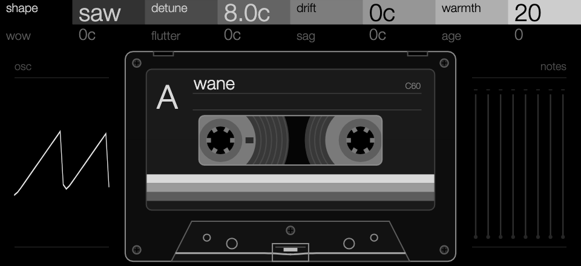
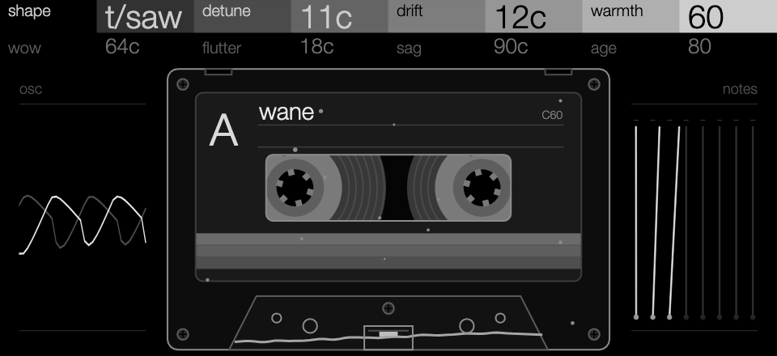
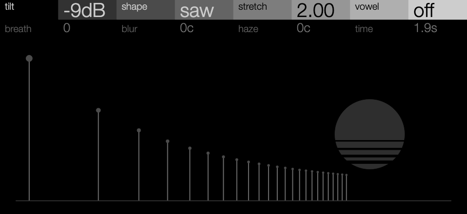
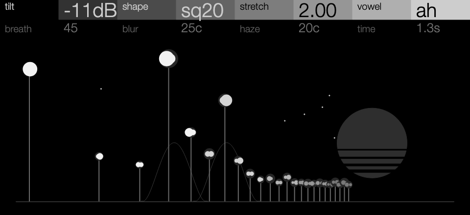
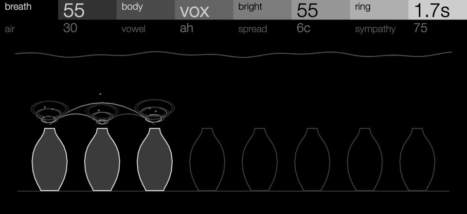
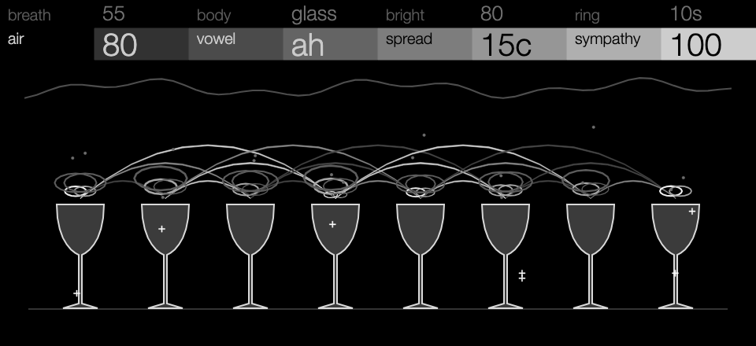

# OP-XY Hexagon

Synths for the OP-XY, built with the
[Open-XY SDK](https://github.com/etcetc000/open-xy), for pads and leads. Three
are here so far, of six: a polysynth heard through worn tape, an additive voice
whose partials drift on their own, and a choir of tuned resonators that ring
into each other. Each one draws its own screen.

**Status: experimental.** All three pass the SDK's tests and compile for the
OP-XY. They have been played on the device, but their CPU cost has only been
estimated on a computer.

## Wane

Detuned, morphing oscillators heard through one worn, shared cassette. Every
note plays through the same tape, so a chord wows, flutters, drags and sags
together. Age dulls the highs and adds saturation and hiss.

| Clean | Attic, three notes held |
| --- | --- |
|  |  |

**shape · detune · drift · warmth** / **wow · flutter · sag · age**.
The screen is a C60 cassette drawn to real proportions. Its reels turn while
notes are held, and the tape past the head moves with the same wow and flutter
the audio plays. The waveform shows shape and warmth, a needle lights for each
held note, and dust gathers with age. [More about Wane](wane/README.md).

## Bloom

Additive pads of 24 sine partials, shaped like an analogue wave and sung
through vowel formants, that drift, smear and beat on their own: from a clean
saw through PWM strings and choirs to glittering bells and breathy fog.

| Init, at rest | Tape Choir, three notes held |
| --- | --- |
|  |  |

**tilt · shape · stretch · vowel** / **breath · blur · haze · time**.
Shape runs from saw through square to a narrow pulse; vowel sings oo to ee;
breath makes the partials, pulse width and vowel wander, at a pace time sets
from 30 ms glitter to 30 s, or `hold`; blur smears partials into noise bands
and haze doubles each into a beating pair. The screen is a meadow of partials
drawn from the engine's own levels and pitches, with the vowel's formants as
hills behind it and haze's pairs as twin blossoms. [More about Bloom](bloom/README.md).

## Hollow

A resonator choir: breath and a soft bow through tuned bodies, morphing from a
sung vowel through a string and a stopped pipe to glass. Held notes ring
sympathetically in one another, so a chord blooms into one sound.

| Choir, three notes held | Glass, page 2, eight notes held |
| --- | --- |
|  |  |

**breath · body · bright · ring** / **air · vowel · spread · sympathy**.
The screen is a shelf of eight vessels in the body's shape: urns, string
bodies, organ pipes or wine glasses. Each held note lights one, which rings out
for the ring time shown. Ripples rise rounder for oo and flatter for ee, and
arcs join notes as sympathy rises. [More about Hollow](hollow/README.md).

## Playing them

Choose Wane, Bloom or Hollow on an instrument track. Each has eight controls on
two pages: press any encoder to switch pages, and Shift + turn makes fine
steps. The controls that colour the sound (Wane's tape, Bloom's breath,
Hollow's sympathy) start at zero; each machine's presets, in its
`definition.json`, turn them up. The OP-XY's own
envelopes, LFOs, filter and effects apply as for any instrument.

All the notes of one machine share one state across tracks, so Wane's tape,
Bloom's weather and Hollow's sympathy also join notes on different tracks that
use the same machine.

Each voice sits low enough that a chord of eight notes keeps headroom: every
preset's eight-note chord peaks between 0.4 and 0.8 of full scale, before the
OP-XY's own envelope, filter and effects.

Spread on Hollow is a chorus within each voice. Synth voices are mono in the
Open-XY SDK, so it can't pan voices apart; the OP-XY's own chorus on a send
adds width.

## Building

The machines need SDK 1.4 (the two-page header), on the `staging` branch of
[etcetc000/open-xy](https://github.com/etcetc000/open-xy). Check it out beside
this repository as `../open-xy`, fetch its toolchain
(`python sdk.py toolchain fetch`), then:

```sh
python ../open-xy/sdk.py test --machine wane --machine bloom --machine hollow
python ../open-xy/sdk.py build --machine wane --machine bloom --machine hollow --stock-os <your stock-1.2.1>/os.ldr --layout <your last build's layout.json> --out <folder outside this checkout>
```

Then install the build's `candidate/` files as the SDK's
[build guide](https://github.com/etcetc000/open-xy/blob/staging/docs/build.md#5-install)
describes. Pass your last build's `layout.json` so the machines already on your
OP-XY keep their numbers.

They ask for these numbers; a build gives them out when they're free:

| | Engine | Page |
| --- | --- | --- |
| Wane | 59 | 107 |
| Bloom | 60 | 108 |
| Hollow | 61 | 109 |

## Develop

Each machine's folder holds its engine (`engine.cpp` and its headers), its
screen (`display.cpp`, with the artwork `panel.svg.fragment` written by
`tools/make_panel.py`) and its sound tests (`tests/sound.cpp`, run by
`sdk.py test`). The screenshots in `docs/screens` are the machines' real
display code, run through the SDK's browser preview, with Helvetica Neue
standing in for the OP-XY's Univers.

## Licence

MIT ([LICENSE](LICENSE)).
