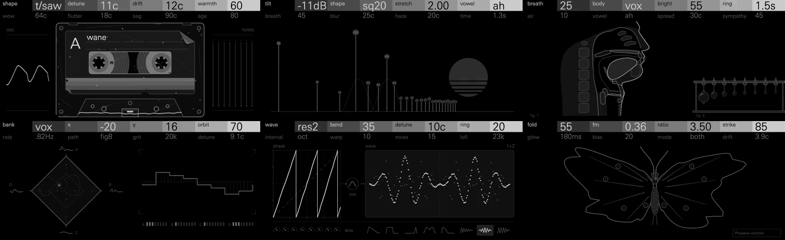
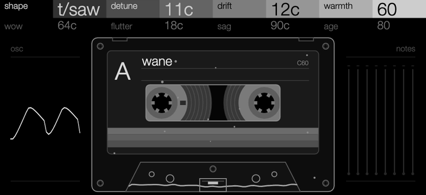
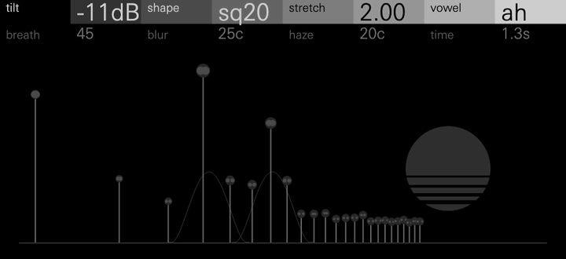
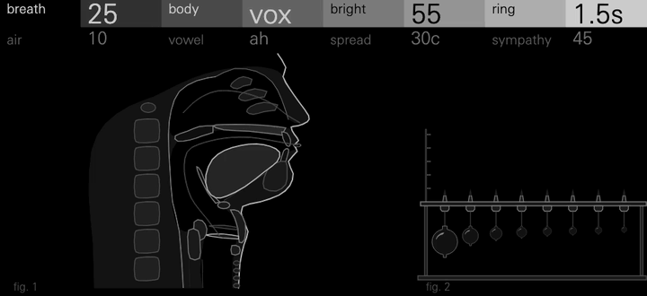
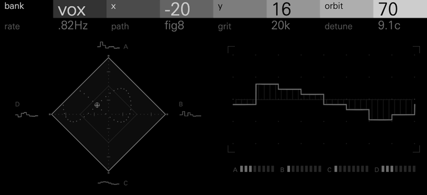
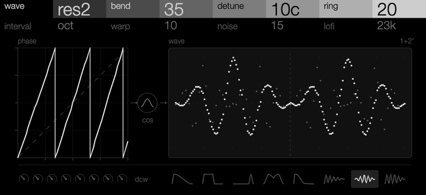
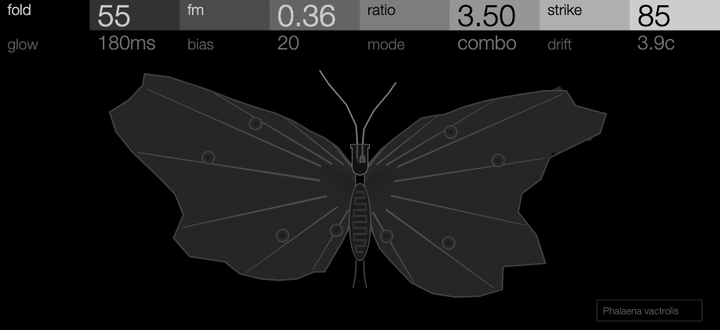

# Hexagon Suite



Six synths for the OP-XY, built with the
[Open-XY SDK](https://github.com/etcetc000/open-xy). Each one starts from an
analog or acoustic way of making sound (tape, drifting partials, resonating
bodies, vector mixing, phase distortion, a west-coast oscillator and
lowpass gate) and rebuilds it the OP-XY way: eight controls on two pages, the
OP-XY's own envelopes, filter, LFOs and effects on top, and a screen that
shows what the sound is doing. They are meant to be used together, with
matched levels and a shared layout, so they layer and swap cleanly within a
project.

**Status: experimental.** All six pass the SDK's tests and have been played on
the OP-XY, and their CPU use has been measured on it (below).

## The synths

<table>
<tr>
<td width="50%"></td>
<td>

### Wane

A polysynth played through a worn cassette. Each note has two detuned
oscillators (sine through saw to a narrow pulse), a sub-oscillator and a
little noise. Every note goes through the same tape, so wow, flutter and sag
move the whole chord together. Age dulls the top end and adds hiss and
saturation.

**Page 1:** shape, detune, drift, warmth<br>
**Page 2:** wow, flutter, sag, age

The screen is a C60 cassette. Its reels turn and its tape moves with the wow
and flutter you hear, and a needle lights for each held note. Age leaves the
cassette scratched, dusty and peeling. *Shown: Attic, four notes, then wow
turned up.*
[More about Wane](wane/README.md)

</td>
</tr>
<tr>
<td width="50%"></td>
<td>

### Bloom

An additive synth built from 24 sine partials. Shape sets the wave they add
up to (saw, square or a narrow pulse) and vowel adds formants from oo to ee.
Breath, blur and haze make the partials drift, smear into noise and beat
against detuned copies; time sets how fast, from a fast shimmer to slow
change, or frozen.

**Page 1:** tilt, shape, stretch, vowel<br>
**Page 2:** breath, blur, haze, time

The screen draws each partial as a stem at its pitch and level, with the
vowel's formants as hills behind them. *Shown: Tape Choir, vowel swept from oo
to ee, then haze turned up.* [More about Bloom](bloom/README.md)

</td>
</tr>
<tr>
<td width="50%"></td>
<td>

### Hollow

A blown and bowed resonator. Breath and a soft bow drive eight tuned
resonances shaped like a voice, a string instrument's body, an organ pipe or
a glass. Notes held together resonate with each other (sympathy), and spread
adds slowly drifting sharp and flat copies of each resonance, like an
ensemble.

**Page 1:** breath, body, bright, ring<br>
**Page 2:** air, vowel, spread, sympathy

The screen is a 19th-century acoustics plate: the body in section (a voice,
a violin, an organ pipe or wine glasses) with its standing wave drawn inside,
and a row of resonators whose flames burn as high as each resonance rings.
*Shown: Ensemble, four notes, then body swept from voice to glass.* [More about Hollow](hollow/README.md)

</td>
</tr>
<tr>
<td width="50%"></td>
<td>

### Orbit

A vector synth, after the Prophet VS. Four single-cycle waves from one of
eight banks sit at the corners of a diamond, and a point inside it sets the
mix. The point travels a path around a centre (circle, ellipse, figure 8 or
steps from corner to corner), so the sound moves by itself. Grit plays it
through an old DAC, down to 10 kHz and 8 bits.

**Page 1:** bank, x, y, orbit<br>
**Page 2:** rate, path, grit, detune

The screen is the VS's joystick field: the corner waves, each note's point on
its path with a trail, and the mixed wave on a scope. *Shown: Dusty, three
notes, then orbit widened and path turned to steps.*
[More about Orbit](orbit/README.md)

</td>
</tr>
<tr>
<td width="50%"></td>
<td>

### Bend

Phase distortion, after the Casio CZ. Each note plays two lines that read a
sine through a bent phase map. Bend straightens or bends the map, from a pure
sine to saw, square, pulse or one of three resonant waves that sweep like a
filter. Each note starts brighter and settles, so the resonant waves wah.
Line 2 can sit at an interval, detuned or ring-modulated.

**Page 1:** wave, bend, detune, ring<br>
**Page 2:** interval, warp, noise, lofi

The screen is drawn like the CZ manual: the phase map beside the waveform it
makes, a dial per note showing its bend, and the eight waves. *Shown: Haze,
three notes, then bend turned up.* [More about Bend](bend/README.md)

</td>
</tr>
<tr>
<td width="50%"></td>
<td>

### Moth

A west-coast voice, after Buchla. A sine is frequency-modulated, folded, then
sent through a vactrol lowpass gate that opens on each note and closes slowly.
With strike up, every note is a pluck, a mallet or a bongo; with strike at 0
it holds like a soft pad. Glow sets how slowly the gate closes, and mode
whether it filters, fades or both.

**Page 1:** fold, fm, ratio, strike<br>
**Page 2:** glow, bias, mode, drift

The screen is a moth on a specimen plate, drawn in outline. Its wing edges are
the folded waveform, frayed by fm, and its body is the vactrol's LED and
photocell; each strike lights an inner edge that fades at glow's pace. *Shown: Ping, a plucked line, then fold turned up.*
[More about Moth](moth/README.md)

</td>
</tr>
</table>

## Playing them

Choose a synth on an instrument track. Press any encoder to switch between
the two pages; Shift + turn makes fine steps. Controls that colour the sound
start at zero, and each synth's presets show what they do.

All notes of one synth share some state across tracks: Wane's tape, Bloom's
slow drift and Hollow's sympathy. Two tracks using the same synth will move
together.

Levels are matched across the set. An eight-note chord on any preset peaks
between 0.4 and 0.8 of full scale, leaving room for the OP-XY's own filter and
effects.

Synth voices are mono in the Open-XY SDK, so Hollow's spread thickens each
voice rather than panning. For width, send it to the OP-XY's chorus.

## CPU

Measured on an OP-XY (OS 1.2.1) with the SDK's `profile benchmark`, three
runs each: one voice playing middle C with the first four controls at their
midpoint, as a share of the OP-XY's audio block.

| Synth | One voice | Eight voices |
| --- | ---: | ---: |
| Wane | 4.1% | ~33% |
| Bloom | 6.2% | ~50% |
| Hollow | 4.9% | ~39% |
| Orbit | 2.4% | ~19% |
| Bend | 2.6% | ~21% |
| Moth | 4.9% | ~39% |

The OP-XY's own engines measure 1.6–2.7% a voice in the same test. Orbit and
Bend are in that range; Wane, Hollow and Moth cost about twice as much, and
Bloom about two and a half times. A full chord on one track is fine; several
tracks of big Bloom or Hollow chords at once, with effects, can run out. The
test plays one setting; heavier settings cost more, and the screens are not
included.

## Building

The machines need SDK 1.4 (the two-page header), on the `staging` branch of
[etcetc000/open-xy](https://github.com/etcetc000/open-xy). Check it out beside
this repository as `../open-xy`, fetch its toolchain
(`python sdk.py toolchain fetch`), then:

```sh
python ../open-xy/sdk.py test --machine wane --machine bloom --machine hollow --machine orbit --machine bend --machine moth
python ../open-xy/sdk.py build --machine wane --machine bloom --machine hollow --machine orbit --machine bend --machine moth --stock-os <your stock-1.2.1>/os.ldr --layout <your last build's layout.json> --out <folder outside this checkout>
```

Then install the build's `candidate/` files as the SDK's
[build guide](https://github.com/etcetc000/open-xy/blob/staging/docs/build.md#5-install)
describes. Pass your last build's `layout.json` so the machines already on your
OP-XY keep their numbers.

They ask for these numbers; a build gives them out when they're free:

| | Engine | Page |
| --- | --- | --- |
| Wane | 59 | 107 |
| Bloom | 60 | 108 |
| Hollow | 61 | 109 |
| Orbit | 37 | 110 |
| Bend | 38 | 111 |
| Moth | 39 | 112 |

## Develop

Each synth's folder has its engine (`engine.cpp` and headers), its screen
(`display.cpp`, with artwork in `panel.svg.fragment` generated by
`tools/make_panel.py`) and its tests (`tests/sound.cpp`, run by `sdk.py
test`). The animations in `docs/screens` are rendered from the real display
code through the SDK's browser preview, at the OP-XY's 480 × 220 and in its
screen font, Univers Next Pro Light, by
[mmockett/OP-XY's renderer](https://github.com/mmockett/OP-XY/tree/main/tools/render).

## Licence

MIT ([LICENSE](LICENSE)).
